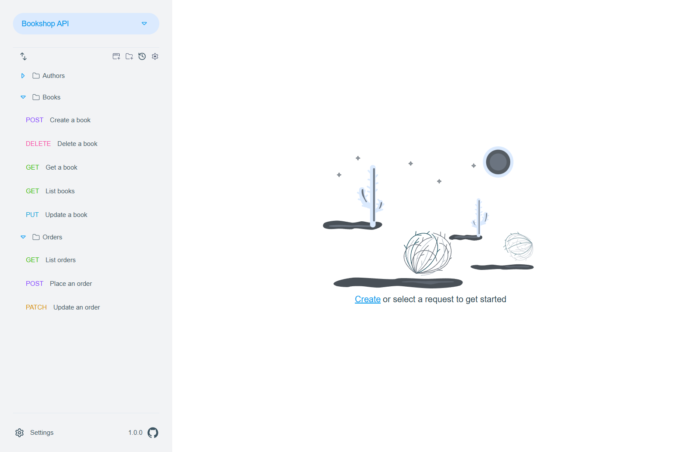
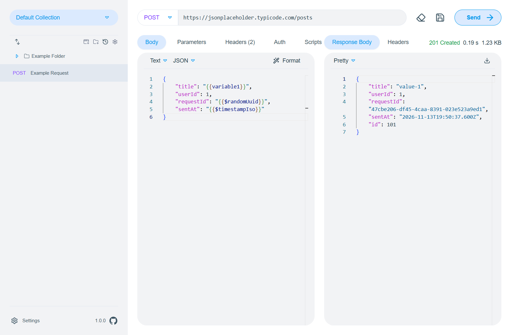

[](https://github.com/EXXETA/trufos/actions/workflows/ci.yml)

[](https://discord.gg/sb4nfdevpW)


<h1 align="center">Trufos — The REST Utility, Free and Open Source</h1>
<p align="center">
  A fast, offline-first REST client with no account required and no telemetry.
</p>

<picture>
  <source media="(prefers-color-scheme: dark)" srcset="docs/images/screenshot-empty-state-dark.png">
  
</picture>

<picture>
  <source media="(prefers-color-scheme: dark)" srcset="docs/images/screenshot-request-variable-dark.png">
  
</picture>

Trufos stores your collections as plain JSON files on disk, making them easy to version-control, diff, and share. It works fully offline — no registration, no cloud sync, no telemetry.

**Features:**

- **Cross-platform** — Windows, macOS, and Linux via Electron
- **Offline-only** — all data stays on your machine, no account and no telemetry
- **Version control-friendly** — collections are plain JSON files; changes made outside the app (e.g. a `git pull`) are reloaded automatically
- **Requests** — URL and header syntax highlighting, header suggestions, text, file and form-data bodies, cancelling running requests, and detailed error information when a request fails
- **Responses** — handles large payloads without blocking the UI, previews images, and lets you download the body as a file
- **Collections** — folders, drag-and-drop ordering, sorting, copying, multi-select with bulk actions, and unsaved drafts you can discard
- **Environments & variables** — collection and environment variables in URLs and headers, plus built-in system variables
- **Authentication** — Basic, Bearer, Digest, OAuth 1.0 and OAuth 2.0 (client credentials, authorization code, authorization code with PKCE, endpoint discovery from the issuer URL); folders and requests can inherit authorization and headers from their parent
- **Client certificates** and optional acceptance of self-signed certificates
- **Scripting** — pre-request and post-response scripts with access to variables
- **Collection runner** — send a selection of the requests of a collection in one go
- **History** — browse previously sent requests with their responses and script logs
- **Import & export** — import Postman, Bruno, and OpenAPI 3 / Swagger 2 collections; export collections as ZIP
- **Plugins** — importers ship as bundled plugins that are managed on the plugins page
- **MCP server** — let AI agents read, edit, and send the requests of your collection (optional, off by default)
- **Command palette, hotkeys, and themes** — light and dark mode; the app remembers its window and state across restarts

## Installation

Grab the latest release from the [GitHub Releases](https://github.com/EXXETA/trufos/releases) or the [Download](https://exxeta.github.io/trufos/download) page:

- **Windows:** `Setup.exe` installer
- **macOS:** `.dmg` image
- **Linux:** `.deb` installer or `.zip` archive

## Requirements

Trufos is an Electron application and runs on Windows, macOS, and Linux. To build or develop locally you need Node.js 24. This project uses **yarn** — do not use npm to install dependencies. If you're using yarn for the first time on your machine, run `corepack enable` before continuing. This project ships yarn with it, you don't need to install it manually on your machine.

### Local Development

```sh
git clone https://github.com/EXXETA/trufos
cd trufos
yarn install
yarn start
```

### Building

```sh
yarn install
yarn run make
```

The output lands in `out/make` — a `Setup.exe` on Windows, `.dmg` on macOS, and `.deb`/`.zip` on Linux.

### Development Commands

| Command               | Description                                       |
| --------------------- | ------------------------------------------------- |
| `yarn start`          | Run the app in development mode (Electron + Vite) |
| `yarn make`           | Package distributables for the current OS         |
| `yarn test`           | Execute Vitest test suite                         |
| `yarn e2e`            | Run Playwright E2E tests (after `yarn package`)   |
| `yarn lint`           | Run ESLint over TypeScript & React sources        |
| `yarn typecheck`      | Type-check all TypeScript projects                |
| `yarn prettier`       | Format code (TS/TSX) with Prettier                |
| `yarn prettier-check` | Check formatting without writing changes          |

## Usage

### Importing Collections

Open the collection import view, pick the format (Postman v2.1, Bruno, or OpenAPI 3 / Swagger 2), select the file or directory, and confirm. Trufos converts and saves it under a folder named after the collection title. Each importer is a bundled plugin and can be managed on the plugins page.

### Exporting Collections

Collections can be exported as a ZIP archive, e.g. to share them with someone who does not use version control.

### Environments & Variables

Define named environments (e.g. `dev`, `staging`, `prod`) each with their own variables. Switching environments scopes variable resolution across all requests. Environments are stored as JSON alongside your collections. Scripts can read and update variables, too.

### Collection Runner

Open **Collection → Run Collection**, pick the requests to send, and see the result of each request at a glance.

### MCP Server

Trufos can run a local [MCP](https://modelcontextprotocol.io) server so AI agents can find, read, edit, and send the requests of the open collection with your environments, variables, and authorization. Everything an agent does shows up live in the app: sent requests appear in the history, edits appear as drafts. The server is disabled by default, only listens on `127.0.0.1`, and requires an access token whose permissions you control in the settings. See [the architecture document](docs/architecture/05_mcp_server.md) for details.

## FAQ

**Where are my saved requests?**

- macOS: `~/Library/Application Support/Trufos/default-collection`
- Windows: `%AppData%\Trufos\default-collection`
- Linux: `~/.config/Trufos/default-collection`

Other collections live wherever you created or opened them.

**Where are the logs?**

- macOS: `~/Library/Logs/Trufos`
- Windows: `%AppData%\Trufos\logs`
- Linux: `~/.config/Trufos/logs`

You can also open it via **Help → Open Logs Folder**.

## Contributing

Check out the [Contributing Guidelines](./CONTRIBUTING.md) and [Code of Conduct](./CODE_OF_CONDUCT.md) before you start. Feedback, suggestions, and feature requests are welcome.

## Licence

Licensed under GPL v3.0.
